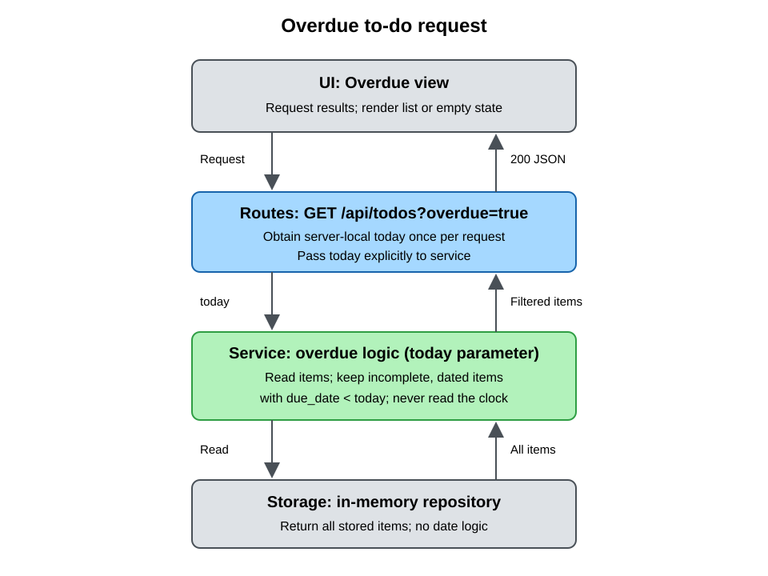

# Due dates and Overdue view

## Goal

Extend the existing minimal to-do app with optional calendar due dates and an Overdue view so a live-demo user can create dated items, change or clear their dates, and see only incomplete items whose due dates have passed, without changing the existing architecture or adding dependencies.

## Decisions

- **Date format:** Optional calendar date, `YYYY-MM-DD`; not a timestamp.
- **Overdue:** Incomplete items due strictly before today. Items due today are not overdue.
- **Editing:** Set dates when adding items; allow setting, changing, and clearing dates on existing items.
- **Calendar reference:** Server local date, rather than browser local time or UTC.

## Behavior and acceptance criteria

### Due dates

- Extend `Todo` and `TodoCreate` with optional `due_date`, defaulting to `None`. JSON responses serialize it as `YYYY-MM-DD` or `null`.
- Existing creation requests without a due date remain valid and create undated items.
- `POST /api/todos` accepts an optional due date and returns the created item with status 201.
- Add `PATCH /api/todos/{id}/due-date`. Its body must contain `due_date`: a date string sets or changes the date; `null` clears it.
- The update returns the persisted item with status 200 and preserves its ID, title, and completion state.
- Missing update fields, impossible dates, timestamps, numeric epochs, and other non-date inputs return 422 without changing storage.
- Updating an unknown ID with a valid body returns 404 using the existing not-found behavior.
- Completing an item preserves its due date. Deleting an item retains the existing behavior.

### Overdue filtering and date logic

- `GET /api/todos` continues to return all items, including completed and undated items.
- `GET /api/todos?overdue=true` returns only items satisfying all three conditions:
  - `is_complete` is false.
  - `due_date` is not null.
  - `due_date < today`.
- Today, future dates, completed items, and undated items are excluded from Overdue. Preserve insertion order in both views.
- Routes call service only; service calls storage. Storage performs data access, not overdue classification.
- The route obtains the server-local date once per overdue request and passes it to service as an explicit `today: date` parameter.
- Service date logic must require `today` as an argument. Never call `date.today()` inside service functions or use a hidden clock/default date there.
- Route-level clock acquisition must be overridable in tests, such as through a small FastAPI dependency in `routes.py`. Service tests pass a fixed date directly; route tests override that dependency.

### UI

- Extend the existing add form with a labeled optional date input.
- Add accessible All and Overdue view buttons with a visible and programmatic selected state. All is selected initially.
- All requests the unfiltered endpoint; Overdue requests the server-filtered endpoint. Do not duplicate overdue date calculations in JavaScript.
- Display each item's date in a labeled editable date input with an explicit Save action. Saving an empty date sends `null`.
- Preserve safe title rendering, Complete/Delete buttons, visible request errors, and disabled pending controls.
- Keep the selected view after creating, completing, deleting, or editing an item, and reload that view after a successful mutation.
- An overdue item disappears from Overdue after completion, deletion, clearing its date, or moving its date to today or later.
- Provide distinct empty messages: "No to-dos yet." and "No overdue to-dos."
- Treat dates as calendar strings in the browser; do not convert them through UTC timestamps.
- Refresh on view selection and mutations; no automatic midnight refresh is required.

### Compatibility and verification

- Extend existing files and patterns; keep the in-memory repository and existing dependencies.
- Keep `main.py`, the health endpoint, `tests/test_health.py`, and all instruction files unchanged.
- Keep router inclusion before the static mount; do not add endpoints to `main.py`.
- Update existing exact-response assertions to include `due_date: null`.
- Test with fixed dates, including yesterday, today, tomorrow, completed items, and missing dates.
- Update README with the new behavior and API while retaining Setup, Run, Open, and Test.
- Run all pytest tests using the existing `.venv`; do not start a server.

## Request flow

The route supplies `today`; storage returns stored items to service, which filters them before the route serializes the response for the UI.

## Out of scope

- Application implementation in this documentation-only change.
- Due times, time-zone selection, browser-local date rules, recurring dates, reminders, priorities, or other new item fields.
- Title editing, completion toggling, sorting, pagination, polling, or automatic midnight refresh.
- Databases, persistence across restarts, authentication, new libraries, frameworks, or build tooling.
- Changes to `main.py`, health behavior/tests, instruction files, or production placeholder configuration.
- Server startup or Git commits.
